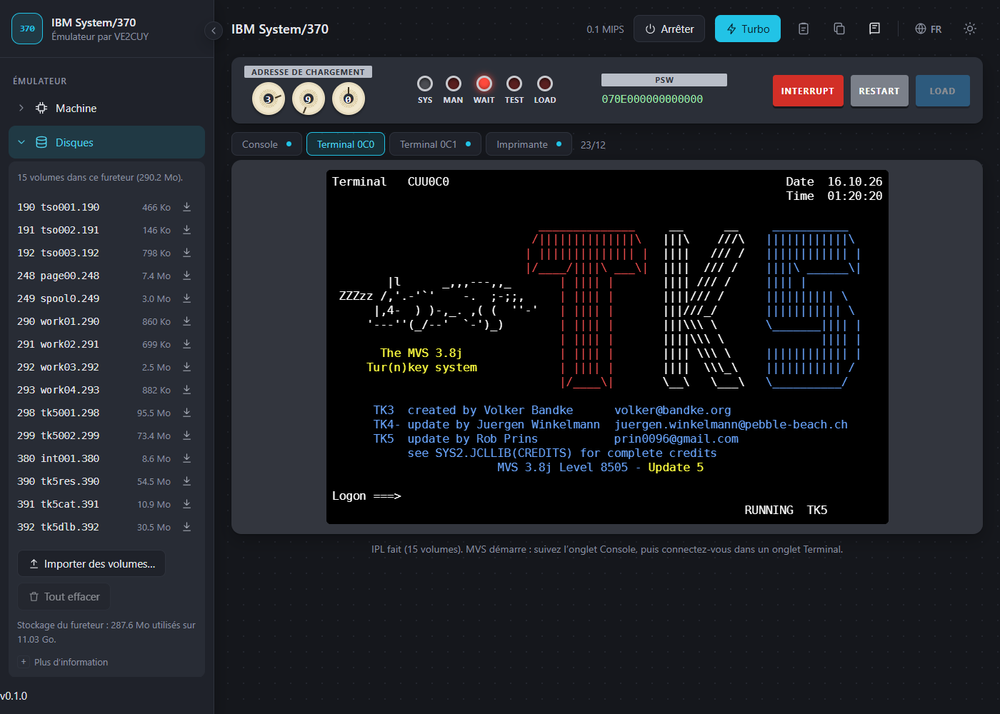

# Émulateur IBM System/370

Un ordinateur central IBM System/370 qui s'exécute dans votre fureteur, écrit en Rust et
compilé en WebAssembly. Il fait tourner **MVS 3.8j** dans la distribution « clés en main »
**TK5** de Rob Prins : JES2, TSO sur des terminaux 3270, compilateurs, lecteur de cartes et
imprimantes.

Vous découvrez l'ordinateur central? Le [guide pas à pas](docs/GUIDE_FR.md) vous mène d'un
fureteur vide à votre première session TSO et à votre premier travail en lots.

**L'essayer : <https://ve2cuy.github.io/ibm-z-emu/>** · [English version](README.md)

## État

- **Processeur** : jeu d'instructions complet du System/370 (entiers, décimal, virgule
  flottante hexadécimale courte, longue et étendue, instructions du système), traduction
  dynamique des adresses, clés de protection, interruptions et minuteries, et les
  instructions de l'« extension S/370 » de Hercules dont TK5 se sert. Écrit d'après les
  *Principles of Operation* d'IBM et comparé à Hercules sur 21 000 instructions aléatoires.
- **Machine** : IBM 3033 de 16 Mo, canaux S/370, disques CKD (3350, 3380, 3390, aux formats
  CKD et CCKD comprimé de Hercules), console de l'opérateur 3215, terminaux 3270 locaux
  (couleurs et attributs étendus), imprimantes 1403 et 3211, lecteur de cartes 3505,
  perforatrice 3525.
- **MVS 3.8j TK5** : IPL, JES2, VTAM et TSO; connexion, mode ligne et applications plein
  écran; travaux en lots soumis par le lecteur de cartes.
- **Page** : console de l'opérateur, terminaux 3270, pupitre d'après celui du System/370
  modèle 148 (cadrans de l'adresse de chargement, LOAD, INTERRUPT, RESTART, voyants),
  sortie des imprimantes, quatre langues (anglais, français, espagnol, chinois).

## Pour commencer

1. Ouvrez l'émulateur. Dans le menu **Dépôt**, téléchargez **MVS 3.8j TK5** (environ
   290 Mo, une seule fois) : les 15 volumes sont gardés dans le stockage de votre fureteur.
2. Appuyez sur **IPL** (ou sur **LOAD** au pupitre; l'adresse de chargement est 390).
3. Suivez l'onglet **Console** : après environ une minute, `IKT007I TCAS ACCEPTING LOGONS`
   annonce que TSO est prêt.
4. Dans l'onglet **Terminal 0C0**, tapez `HERC01` à `Logon ===>`, Entrée, puis le mot de
   passe `CUL8TR`.
5. Avant de fermer la page, cliquez sur **Arrêter** et acceptez l'arrêt propre
   (`S SHUTDOWN` de TK5, environ une minute).

Utilisateurs TSO de TK5 : HERC01 et HERC02 (mot de passe CUL8TR), HERC03 et HERC04
(PASS4U).

## Clavier 3270

| Touche du PC | Touche 3270 |
|---|---|
| Entrée | Enter |
| Échap | Clear |
| F1 à F12 (Maj : F13 à F24) | PF1 à PF12 (PF13 à PF24) |
| Page préc. / Page suiv. | PF7 / PF8 |
| Ctrl+1, Ctrl+2, Ctrl+3 | PA1, PA2, PA3 |
| Ctrl+R | Reset (libère le clavier) |
| Fin | Erase EOF |
| Inser, Suppr, Retour arrière, Tab, Maj+Tab, Origine, flèches | comme sur un 3270 |
| Maj+Entrée | Nouvelle ligne |

Les touches peuvent aussi s'afficher sous l'écran (menu Affichage).

## Travaux en lots

Le menu **Lecteur de cartes** envoie un travail au lecteur 3505 de l'adresse 00C, où JES2
le lit. Le résultat paraît dans l'onglet **Imprimante** (imprimante 00E, classe A).

## Disques

Les volumes sont des fichiers du stockage privé du fureteur (OPFS), et MVS les modifie
pendant qu'il tourne, comme de vrais disques. Le menu **Disques** les énumère, enregistre un
volume sur votre PC et importe des volumes au format de Hercules (le dossier `dasd` de TK5,
par exemple; chaque nom de fichier finit par l'adresse de l'unité, comme `tk5res.390`).

## Remerciements et licences

- Émulateur : © 2026 Alain Boudreault (VE2CUY), licence Apache 2.0 ([LICENSE](LICENSE),
  [NOTICE](NOTICE)).
- MVS 3.8j : IBM, domaine public. TK5 : Rob Prins, sur le travail de Volker Bandke (TK3) et de
  Juergen Winkelmann (TK4-), et de nombreux contributeurs (voir `SYS2.JCLLIB(CREDITS)` dans
  TK5). Les volumes viennent de <https://www.prince-webdesign.nl/tk5>.
- Le comportement du processeur a été vérifié avec l'émulateur
  [Hercules](https://github.com/SDL-Hercules-390/hyperion), lancé comme référence; aucune
  partie de son code n'est incluse.
